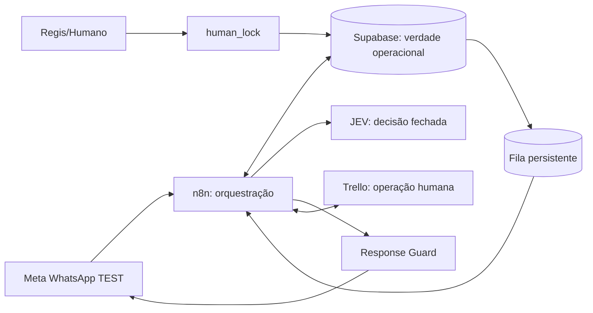

# Mapa arquitetural consolidado

## Dependências

| Dependência | Função | Regra |
|---|---|---|
| Supabase | estado, fatos, propostas, fila, auditoria | fonte canônica |
| Meta | recepção e confirmação de envio | número de teste nesta fase |
| Trello | agenda e cartão comercial | cartão apenas ao fim do orçamento |
| JEV | ambiguidade e decisão em vocabulário fechado | nunca calcula preço |
| Whork | executor das atividades antes atribuídas ao Codex | sem poderes para ativar produção nesta OS |

## Lacunas verificadas

1. Não foi disponibilizado o repositório/branch nem os artefatos Graphify citados na OS.
2. Não foi disponibilizada a planilha homologada com o nome citado na OS para validar o adaptador de preço.
3. Não há worker de fila, envio Meta, registro de confirmação ou criação Trello observados nos fluxos analisados.
